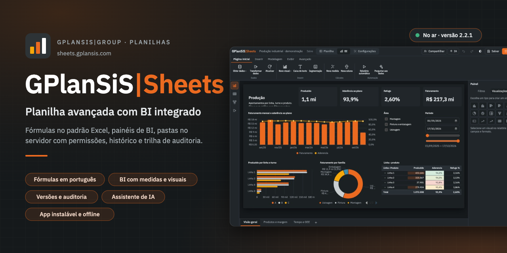
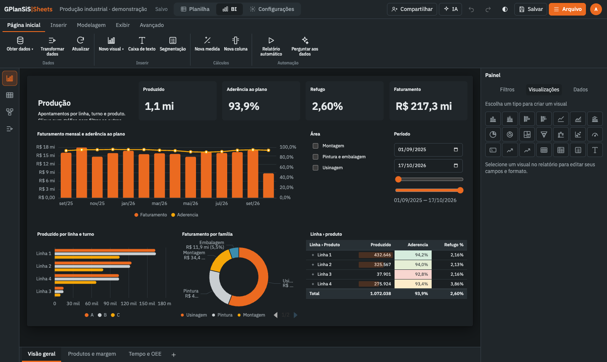
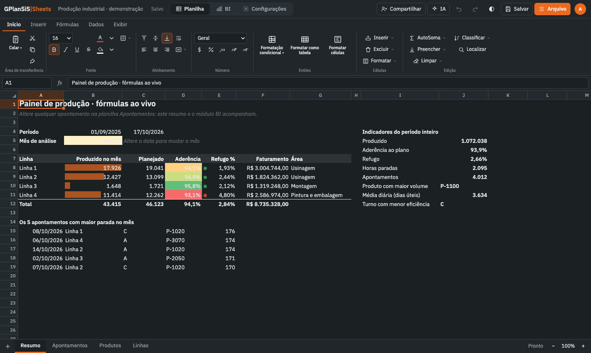
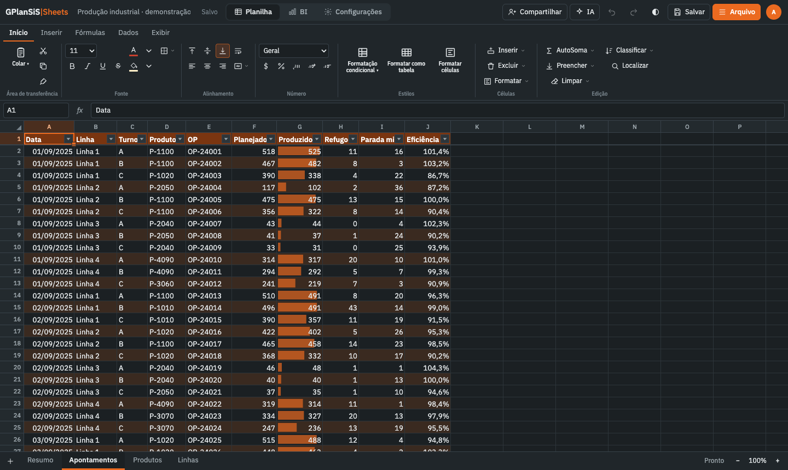
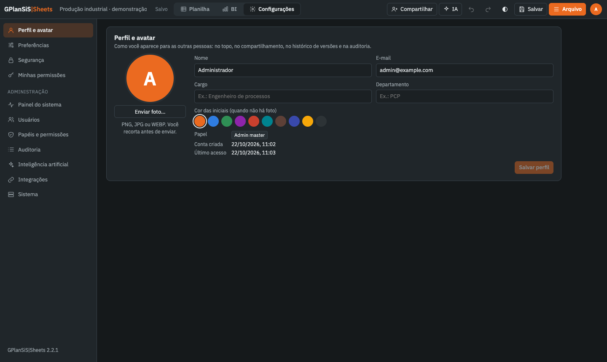
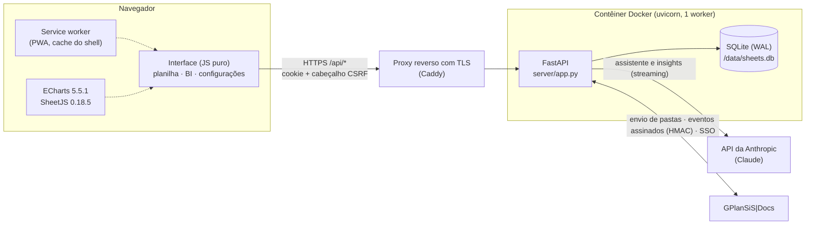

<p align="center">
  <a href="https://sheets.gplansis.com"></a>
</p>

<h1 align="center">GPlanSiS|Sheets</h1>

<p align="center">
  <b>Planilha avançada no padrão Excel, com módulo de BI integrado, multiusuário, histórico de versões e auditoria.</b>
</p>

<p align="center">
  <a href="https://sheets.gplansis.com"></a>
  
  <a href="LICENSE"><">
</p>

<p align="center">
  
  
  
  
  
  
  
</p>

<p align="center">
  <a href="https://sheets.gplansis.com"><b>Abrir o GPlanSiS|Sheets →</b></a>
  &nbsp;·&nbsp; <a href="#como-rodar-localmente">Rodar localmente</a>
  &nbsp;·&nbsp; <a href="#contribua">Contribua</a>
</p>

---

## O que é

O **GPlanSiS|Sheets** é uma planilha que roda no navegador, com fórmulas no padrão Excel (em português), tabelas estruturadas, formatação condicional e validação de dados, e um **módulo de BI** no mesmo arquivo: consultas, modelo de dados, medidas, colunas calculadas e painéis interativos. A versão de servidor acrescenta login, papéis e permissões, pastas guardadas no servidor com histórico de versões, compartilhamento, presença de quem está na mesma pasta e uma trilha de auditoria encadeada.

Faz parte do ecossistema **GPlanSiS|Group** e se integra ao **GPlanSiS|Docs** (lista mestra de documentos e fluxo de revisão).

## Funcionalidades

| Área | O que tem |
|---|---|
| **Planilha** | Grade em canvas, fórmulas em português (`PROCV`, `PROCX`, `SOMASES`, `FILTRO`, `CLASSIFICAR`, `ÚNICO`, `LET` e outras), matrizes dinâmicas, tabelas estruturadas (`TbProducao[Data]`), formatação condicional (barras, escalas, regras), validação de dados, filtros, congelar painéis, zoom, várias planilhas por pasta. |
| **Importar e exportar** | `.xlsx`, `.xls`, `.xlsm`, `.ods`, `.csv`, `.tsv`, `.txt` e o formato nativo `.json` (com o BI). Exportação para Excel (`.xlsx`), `.json` nativo e CSV dos dados de um visual do BI. O PDF é gerado no envio ao GPlanSiS\|Docs. |
| **BI integrado** | Obter e transformar dados, modelagem com relacionamentos, medidas e colunas calculadas, visuais (colunas, barras, linhas, área, combinado, pizza, rosca, treemap, funil, cascata, dispersão, medidor, cartão, KPI, tabela, matriz, segmentação, texto), filtros cruzados, várias páginas de relatório. |
| **BI avançado** | Paletas (inclusive acessível para daltonismo), indicadores que salvam filtros, % do total, acumulado, Pareto, variação %, linhas de média/mediana/meta, tendência linear com R² e previsão de até 24 períodos, marcação de anomalias (±2σ), cor condicional, escala logarítmica, zoom. |
| **Assistente de IA** | Assistente de fórmulas, "Perguntar aos dados" e insights do BI pelo servidor (Claude, da Anthropic). A chave é cadastrada pela interface, validada, guardada cifrada e nunca volta ao navegador. Sem chave, o "Perguntar aos dados" funciona por palavras-chave. |
| **Acesso** | Login por e-mail e senha (scrypt), cookie HttpOnly/SameSite=Strict, proteção CSRF, bloqueio após tentativas, limite por IP, troca de senha obrigatória no primeiro acesso, encerramento remoto de sessões. |
| **Papéis e permissões** | Admin master, Administrador, Gestor, Analista de BI, Editor e Leitor, com 14 permissões granulares personalizáveis por usuário. |
| **Pastas no servidor** | Salvamento automático, controle de versão otimista (conflitos detectados sem perder nada), histórico de versões (automáticas e nomeadas, com restauração), lixeira, duplicação, compartilhamento por pessoa ou com a organização, presença em tempo real. |
| **Auditoria** | Trilha encadeada (cada evento referencia o anterior), verificação de integridade e exportação CSV. |
| **Configurações** | Perfil e avatar com recorte, preferências (tema claro/escuro, módulo inicial, zoom), segurança, e para administradores: painel do sistema, usuários, papéis, auditoria, IA e integrações. |
| **GPlanSiS\|Docs** | *Arquivo › Enviar ao GPlanSiS\|Docs* cria o documento na lista mestra ou abre a próxima revisão, enviando PDF, Excel e o nativo. Eventos assinados (HMAC) voltam do Docs e aparecem na pasta; entrada única nos dois sentidos. |
| **App e offline** | PWA instalável (manifesto, ícones, service worker), layout para celular, e uma versão `GPlanSiS-Sheets-offline.html` que funciona aberta como arquivo, sem login, guardando no navegador. |

## Telas

| Painel de BI | Planilha com fórmulas |
|---|---|
|  |  |
| **Tabela estruturada com formatação condicional** | **Configurações e administração** |
|  |  |

<sub>Capturas feitas numa instalação local com a pasta de demonstração (dados fictícios de produção industrial).</sub>

## Arquitetura



- **Front-end sem framework nem CDN**: os módulos em `src/` são concatenados por `src/build.py` num único `public/index.html`; ECharts e SheetJS ficam em `public/vendor/`.
- **Um processo, um banco**: a presença fica em memória e a escrita no SQLite é serializada, por isso o contêiner roda com um único worker.
- **Contêiner endurecido**: usuário sem root, sistema de arquivos somente leitura, sem capabilities, `no-new-privileges`, limite de memória e logs com rotação.

## Stack

| Camada | Tecnologia |
|---|---|
| Back-end | Python 3.12, FastAPI, Uvicorn, httpx, SDK `anthropic` |
| Banco | SQLite em modo WAL (usuários, sessões, pastas, ACL, versões, auditoria, configurações) |
| Front-end | JavaScript puro (ES2020+), canvas para a grade, CSS com variáveis de tema, fonte IBM Plex Sans |
| Gráficos e arquivos | Apache ECharts 5.5.1, SheetJS Community Edition 0.18.5 |
| Implantação | Docker / Docker Compose, Caddy como proxy reverso com TLS |

## Como rodar localmente

### Com Python (desenvolvimento)

```bash
git clone https://github.com/SSBianchiplan/sheets.git
cd sheets
python3 src/build.py                      # gera public/index.html, a versão offline e public/sw.js

python3 -m venv .venv && . .venv/bin/activate
pip install -r server/requirements.txt

mkdir -p dados
SHEETS_DATA=./dados \
SHEETS_SECURE_COOKIE=0 \
SHEETS_MASTER_EMAIL=admin@example.com \
SHEETS_MASTER_PASSWORD='Troque-esta-senha-1' \
uvicorn app:app --app-dir server --host 127.0.0.1 --port 8080
```

Abra <http://127.0.0.1:8080>, entre com o e-mail e a senha acima e defina a senha nova (a troca é obrigatória no primeiro acesso). Em *Arquivo › Carregar demonstração industrial* há uma pasta pronta com dados fictícios e um relatório de BI.

> `SHEETS_SECURE_COOKIE=0` só serve para testar em `http://` local. Em produção, deixe o padrão (`1`) atrás de HTTPS.

### Com Docker

```bash
python3 src/build.py
cp .env.example .env                      # edite os valores
docker compose up -d --build
docker logs gplansis-sheets               # mostra a senha inicial se SHEETS_MASTER_PASSWORD estiver vazio
```

O contêiner publica em `127.0.0.1:${SHEETS_PORT}` (padrão 8958). Para produção, coloque um proxy com TLS na frente; `deploy/sheets.caddy` é o bloco usado com o Caddy (ele importa um snippet de cabeçalhos `seguranca_hub` do servidor de origem: remova ou troque pelo seu).

### Só o navegador (sem servidor)

Depois do `python3 src/build.py`, abra `public/GPlanSiS-Sheets-offline.html` direto no navegador. Tudo é guardado localmente, sem login.

### Publicar num servidor

`deploy.sh` roda no servidor (backup do banco, build, subida, espera do healthcheck, `rollback <versão>` e `backup`). `publicar.sh` roda na máquina de desenvolvimento e envia por SSH:

```bash
HOST=meu-servidor DEST=/opt/sheets DOMINIO=sheets.exemplo.com ./publicar.sh
```

Veja [LEIA-ME.md](LEIA-ME.md) para a operação completa (backup, rollback, recuperação do admin master, ligar a IA).

## Estrutura de pastas

```
.
├── server/
│   ├── app.py              # API FastAPI + arquivos estáticos (auth, pastas, versões, ACL, auditoria, IA, Docs)
│   └── requirements.txt
├── src/                    # código-fonte do front-end (concatenado por build.py)
│   ├── 0_head.html, 1_bi.css, 1b_srv.css, 2_body.html
│   ├── a_util.js  b_formula.js  c_model.js  d_grid.js  e_interact.js
│   ├── f_icons.js g_ui.js  h_dialogs.js  i_app.js
│   ├── j_bi_engine.js  k_bi_vis.js  l_bi_ui.js  r_bi_adv.js   # BI
│   ├── m_ai.js  n_demo.js  p_server.js  q_cfg.js  s_docs.js  t_pwa.js  o_boot.js
│   ├── sw.js               # modelo do service worker
│   └── build.py            # gera public/index.html, a versão offline e public/sw.js
├── public/                 # ícones, manifesto, robots.txt e vendor/ (ECharts, SheetJS + licenças)
├── deploy/sheets.caddy     # bloco do Caddy para o domínio
├── Dockerfile, docker-compose.yml, .env.example
├── deploy.sh               # no servidor: backup, build, subida, rollback
└── publicar.sh             # na máquina de desenvolvimento: build + envio por SSH + deploy
```

Os arquivos `public/index.html`, `public/GPlanSiS-Sheets-offline.html` e `public/sw.js` são gerados e não ficam no repositório.

## Variáveis de ambiente

Veja `.env.example`. Nenhum valor real fica no repositório.

| Variável | Para que serve |
|---|---|
| `SHEETS_VERSION` | Tag da imagem Docker (permite rollback) |
| `SHEETS_PORT` | Porta local publicada pelo contêiner |
| `SHEETS_MASTER_EMAIL` | E-mail do admin master, criado na primeira subida |
| `SHEETS_MASTER_PASSWORD` | Senha inicial do master (opcional; vazio gera uma e mostra no log) |
| `SHEETS_SECRET` | Segredo que cifra a chave da IA guardada no banco (o `deploy.sh` gera um se faltar) |
| `ANTHROPIC_API_KEY` | Alternativa ao cadastro da chave pela interface |
| `SHEETS_AI_MODEL` | Modelo padrão do assistente |
| `SHEETS_DOCS_SEGREDO` | Segredo compartilhado com o GPlanSiS\|Docs (vazio desliga a integração) |
| `SHEETS_DOCS_URL`, `SHEETS_DOCS_API`, `SHEETS_URL` | Endereços usados na integração com o Docs |
| `SHEETS_DATA`, `SHEETS_STATIC` | Pasta do banco e pasta dos arquivos estáticos |
| `SHEETS_SECURE_COOKIE` | `1` (padrão) exige HTTPS no cookie; `0` só para teste local |

## Contribua

O GPlanSiS|Sheets é aberto para quem quiser ajudar: desenvolvedores, analistas de dados, quem usa Excel no dia a dia, designers e quem gosta de testar. Toda contribuição conta, de um relato de bug bem descrito a uma função nova.

**Onde dá para ajudar**

- **Fórmulas**: implementar funções do Excel que ainda faltam, corrigir casos de borda (datas, erros `#N/D`, matrizes), escrever casos de teste.
- **BI**: novos visuais, melhorias nas medidas e no modelo, desempenho com tabelas grandes.
- **Importação e exportação**: fidelidade de formatação no `.xlsx`, suporte a mais recursos do `.ods`.
- **Acessibilidade e celular**: navegação por teclado, leitores de tela, contraste, telas pequenas.
- **Back-end e segurança**: testes da API, revisão de permissões, endurecimento.
- **Documentação**: guias de uso, exemplos de fórmulas e de painéis, tradução.

**Boas primeiras issues**

- Atualizar o SheetJS de `0.18.5` para a versão atual distribuída pelo próprio SheetJS (corrige vulnerabilidades conhecidas da 0.18.5) e conferir importação e exportação.
- Criar uma suíte de testes automatizados para `src/b_formula.js` (entrada → resultado esperado).
- Criar testes da API com `pytest` + `httpx` cobrindo login, CSRF, permissões e conflito de versão.
- Documentar a lista de funções suportadas, gerada a partir do código.
- Revisar contraste e rótulos ARIA da faixa de ferramentas.

Comece por [CONTRIBUTING.md](CONTRIBUTING.md), siga o [Código de Conduta](CODE_OF_CONDUCT.md) e, para falhas de segurança, use o canal de [SECURITY.md](SECURITY.md) em vez de uma issue pública.

## Licença

Código próprio sob a **[licença MIT](LICENSE)** — Copyright (c) 2026 GPlanSiS.

Bibliotecas de terceiros incluídas mantêm suas próprias licenças: Apache ECharts e SheetJS Community Edition (Apache-2.0, textos em `public/vendor/`). Dependências Python: FastAPI (MIT), Uvicorn (BSD-3-Clause), httpx (BSD-3-Clause), SDK `anthropic` (MIT). Fonte IBM Plex Sans (SIL Open Font License), carregada do Google Fonts.

## Créditos

Desenvolvido pela **GPlanSiS|Group**. Contato: [contato@gplansis.com](mailto:contato@gplansis.com) · <https://sheets.gplansis.com>
